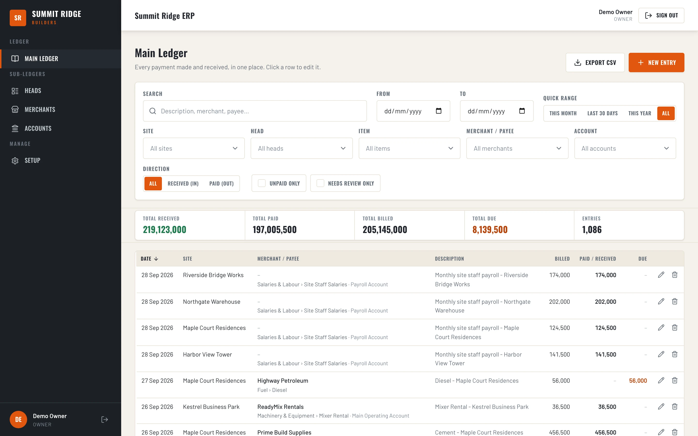
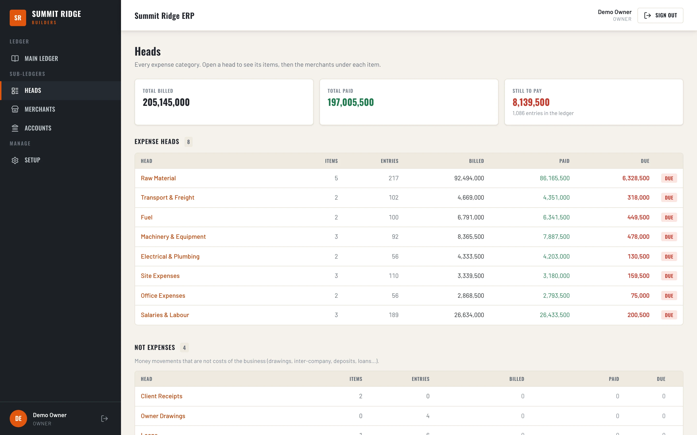
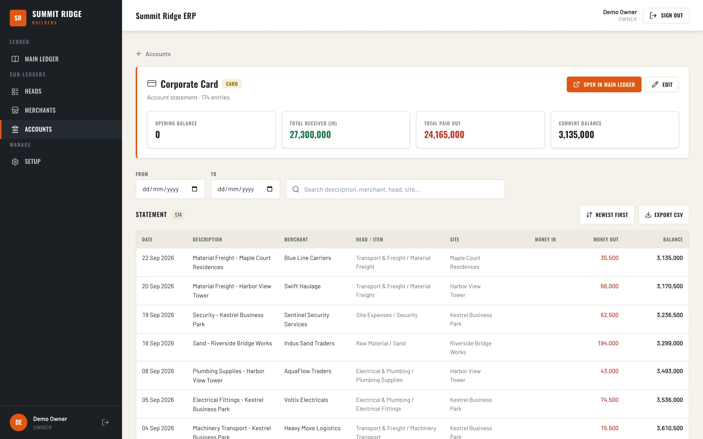
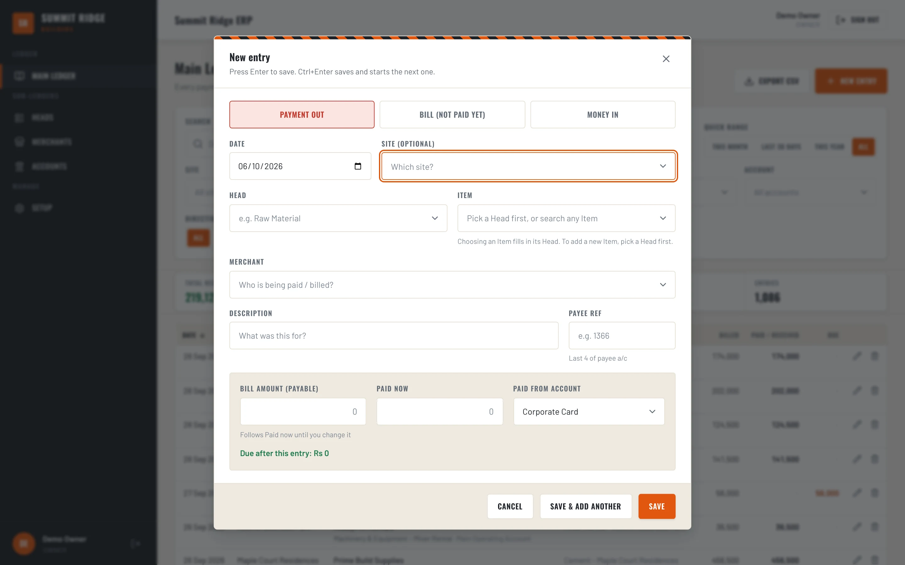
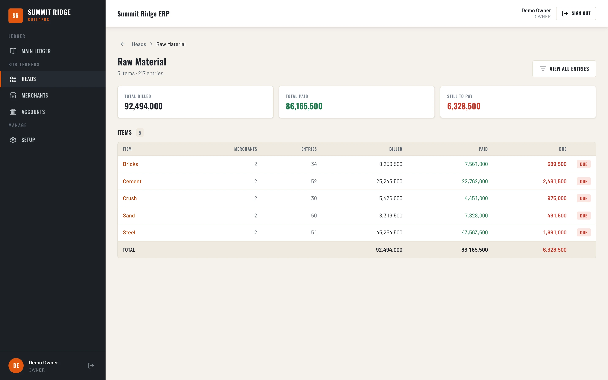
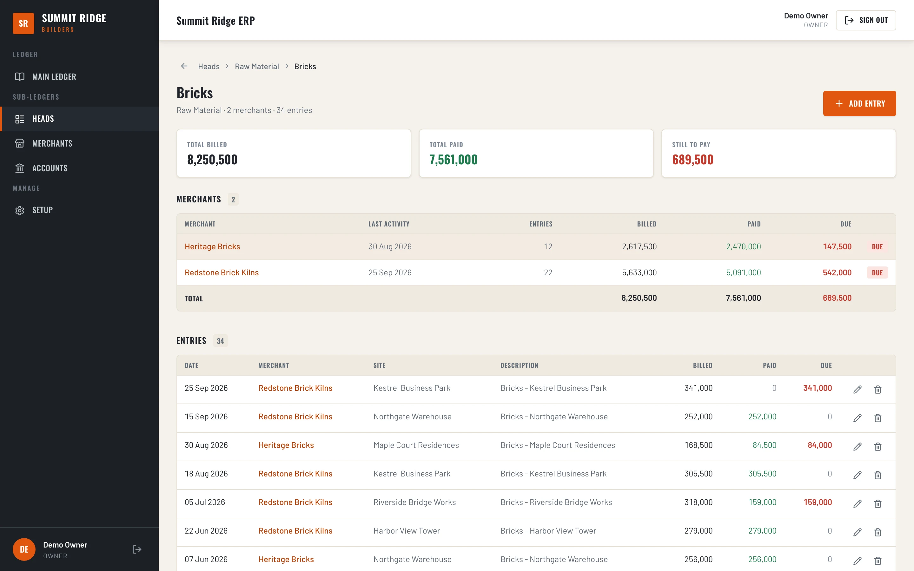
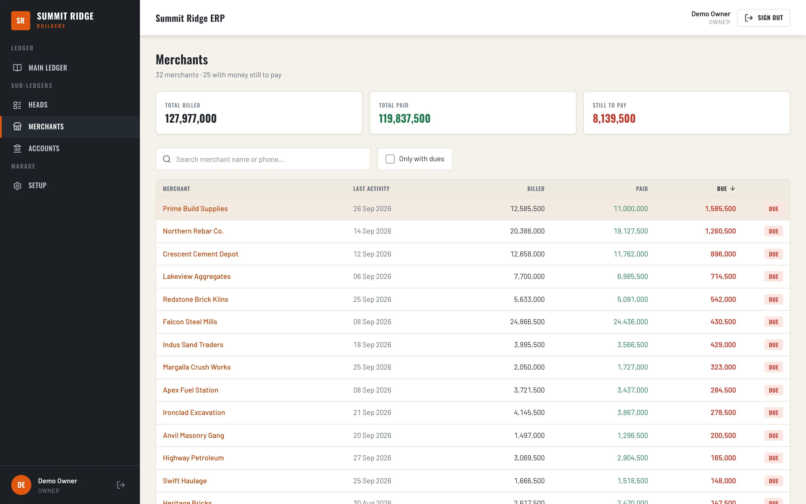
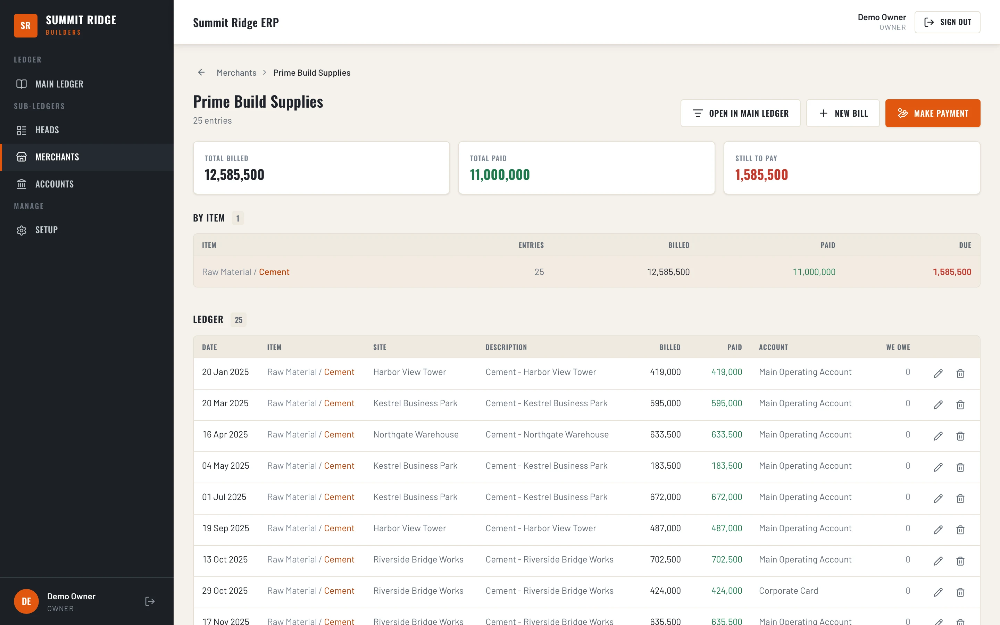
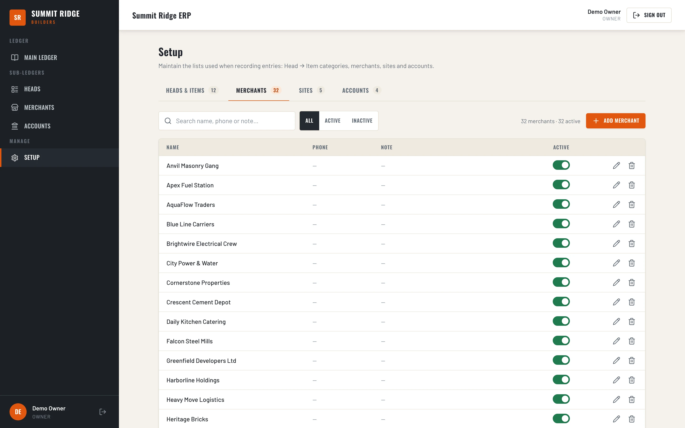
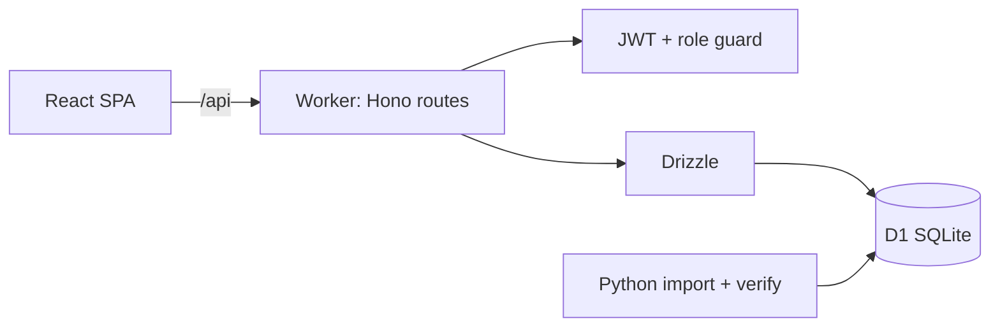

# Construction Ledger ERP

**A web ledger for a construction company: one Main Ledger of payments and receipts, with Head, Item, Merchant and Account drill-downs showing billed, paid and due.**

React · Vite · Tailwind · Cloudflare Workers · Hono · Drizzle · D1 (SQLite)

<table>
  <tr>
    <td></td>
    <td></td>
  </tr>
  <tr>
    <td></td>
    <td></td>
  </tr>
</table>
Screenshots are real captures of a local build running on fictional demo data.

---

## Product at a Glance

| | |
|---|---|
| **What it is** | Accounting ledger that replaces an Excel workbook for a construction company |
| **Core model** | Entries with direction (in/out), billed and paid amounts; due is derived |
| **Views** | Main Ledger, Heads > Items > Merchants, Accounts, Setup |
| **Backend** | Cloudflare Worker (Hono, Drizzle) on D1; R2 binding configured |
| **Auth** | JWT sign-in, read-only VIEWER role, audit log on changes |
| **Migration** | Python Excel import with a verification script |
| **AI** | None; no ML or LLM code |

## Product Showcase

<table>
  <tr>
    <td align="center"> <b>Head detail</b> Items under one head</td>
    <td align="center"> <b>Item detail</b> Merchants under one item</td>
    <td align="center"> <b>Merchants</b> Billed, paid, due per vendor</td>
  </tr>
  <tr>
    <td align="center"> <b>Merchant detail</b> Entries for one vendor</td>
    <td align="center"> <b>Setup</b> Heads, merchants, sites, accounts</td>
    <td align="center"> <b>New entry</b> Payment out, bill, money in</td>
  </tr>
</table>

## Key Features

- **Main Ledger.** Search and filter by date range, site, head, item, merchant, account, direction, unpaid only and needs review; totals for received, paid, billed and due; create, edit and delete entries; CSV export.
- **Sub-ledgers.** Heads drill down to items and merchants, each level showing billed, paid and due.
- **Accounts.** Bank, cash and card accounts with opening balance and a running-balance statement.
- **Setup.** Maintain sites, heads, items, merchants and accounts, with active toggles.
- **Roles.** Sign-in with JWT; the VIEWER role is read-only.
- **Import.** Python pipeline from the legacy Excel workbook to seed SQL, with a verify script.

## Architecture

The SPA calls a Cloudflare Worker that validates input, checks the role, and queries D1 through Drizzle. Details: [docs/ARCHITECTURE.md](docs/ARCHITECTURE.md).

## Engineering Highlights

- **Integer money.** Amounts are stored as integer minor units and converted at the API boundary.
- **Billed versus paid.** Due is derived from the two amounts, so it rolls up consistently across every sub-ledger.
- **Server-side validation.** Direction, amount and account rules are enforced in the Worker.
- **Grouped SQL summaries.** Drill-down totals come from aggregate queries rather than per-row lookups.
- **Verified import.** A script re-derives rows and asserts totals and foreign keys on a scratch database copy.

More: [docs/ENGINEERING_CHALLENGES.md](docs/ENGINEERING_CHALLENGES.md).

## Status and Scope

- This is a production application for one company; the screenshots come from a demo build on a generated, fictional dataset.
- No AI or machine learning is involved.
- An earlier double-entry engine (invoices, GL, reports) exists in the codebase but is not routed in the current app.
- Automated checks are an API smoke-test script and the import verifier; there are no UI tests.
- Production source, data and configuration are private.

## Documentation

| Read | For |
|---|---|
| [Technical case study](docs/TECHNICAL_CASE_STUDY.md) | Problem, approach, decisions |
| [Architecture](docs/ARCHITECTURE.md) | Layers, data model, API surface |
| [Engineering challenges](docs/ENGINEERING_CHALLENGES.md) | Problem, approach, outcome |
| [Product overview](docs/PRODUCT_OVERVIEW.md) | Screens and money model |
| [Privacy and source](docs/PRIVACY_AND_SOURCE.md) | What is and is not published |

## Source Code

Production source code is maintained privately. See [RIGHTS.md](RIGHTS.md) for usage terms.
