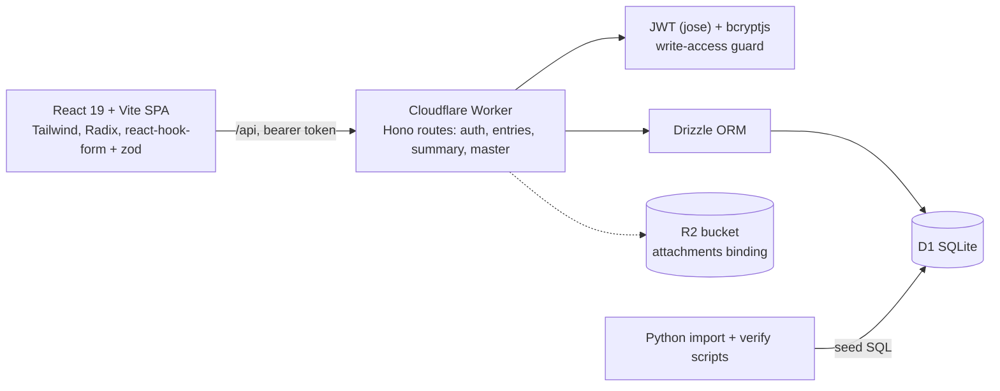

# Architecture

## System layers

The SPA talks only to the Worker's `/api`. The Worker validates input, enforces role checks, runs SQL through Drizzle against D1, and writes audit-log rows on changes. The R2 binding is configured; the attachment routes belong to the earlier engine that is not routed.

## Data model (current ledger)

`sl_site`, `sl_head`, `sl_item` (belongs to a head), `sl_merchant`, `sl_account` (with opening balance) and `sl_entry`. An entry holds date, direction (IN/OUT), optional site/head/item/merchant/account, description, billed, paid, a source (manual or import), and a needs-review flag.

## API surface

- `POST /api/auth/login`, `GET /api/auth/me`
- Entries: list (with totals and filters, limit up to 1000 with offset), get, create, update, delete
- Summaries: heads, head detail, item detail, merchants, merchant detail, accounts, account detail, overall
- Master data: CRUD for sites, heads, items, merchants and accounts

Write endpoints require a non-VIEWER role.

## Data integrity

- Money is stored as integer paisa; the API speaks decimal currency and converts at the boundary.
- Cross-field validation on write: IN entries need a positive paid amount, OUT entries need billed or paid greater than 0, and a paid amount requires an account.
- Summaries use grouped SQL aggregates rather than per-row queries.
- Import and verify scripts are re-runnable and check totals, foreign keys and per-row fields against the source extract.

## Hosting model

Worker plus D1 (and an R2 binding) on Cloudflare; the SPA is a static build. The demo runs the same Worker locally against a seeded local D1 database.
